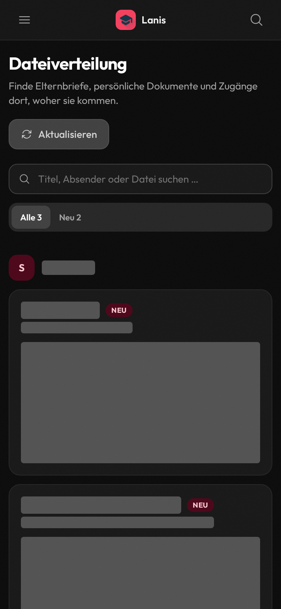

# Deployed-preview live browser validation · 2026-10-18

Tested real sign-ins and live Schulportal responses in the collaborative browser. Dateiverteilung used PR #62's deployed HTTPS preview, including the mobile fix at 21527079ee089368b85aa746a52ac023e6f4e142. Videokonferenz used PR #61's deployed preview; that page is not included in PR #62.

The backend ran the combined API PR branch (ebc6261) in an isolated temporary environment with fresh JWT/encryption keys, its own databases, and a temporary HTTPS tunnel. Production credential records were read through a read-only SQLite connection and decrypted in memory. The real login/authentication and feature endpoints were used. Background notification/metrics-fetch workers were omitted; onboarding preferences were changed only in the temporary database. No portal response was replaced with demo data.

Account aliases below are unrelated to production identifiers.

| Account | Dateiverteilung in PR #62 | Videokonferenz in PR #61 |
| --- | --- | --- |
| A | Successful UI login; correct empty catalog | Successful UI login; 13 live-status rooms; 13 rendered cards; 0 join actions |
| B | Successful UI login; 3 distributions; 2 unread; 1 already-read file | Successful UI login; 12 live-status rooms; 12 rendered cards; 0 join actions |
| C | Successful UI login; correct empty catalog | A direct API probe returned unsuccessful; video UI coverage uses A and B |

The three accounts belong to three schools. Switching accounts cleared browser authentication/cache before signing in again. Catalog counts differed as expected; populated data from B did not appear in A or C.

## Dateiverteilung

- Unread filtering showed 2 of 3 real distributions.
- Searching an existing title showed exactly 1 matching distribution; clearing restored all 3.
- The actual UI download button completed a browser download of an already-read PDF: 511,436 bytes, application/pdf, with the %PDF- signature. The filename came from the download response. No file contents are included here.
- Fresh overview after download still had 2 unread distributions. No unread file was downloaded.
- Manual refresh completed through /dateiverteilung?refresh=true.
- Real long text exposed horizontal overflow at 390px (scroll width 510px). The fix adds a constrained single-column grid, minimum-width resets, and wrapping for long text.
- After the fix deployed, a fresh load of B's real catalog measured viewport width 390px and scroll width 390px. The compiled grid-cols-1 class was present, and no diagnostic/injected stylesheet was present.
- The updated labels, search layout, and retained Neu tags were checked on the real catalog.

The screenshot covers distribution titles, descriptions, dates, source names, and file/link text with opaque bars before capture. It shows real layout geometry; it is not a demo screenshot.

## Videokonferenz

- Real closed-room catalogs were checked at 390px and 1280px without horizontal overflow.
- Normal sidebar navigation reached the native room page. Manual refresh restored the same account's catalog.
- Automatic polling was observed after the manual refreshes, increasing observed video requests from 2 to 4.
- A controlled browser transport failure was injected for one video request. All 12 real room cards remained visible, all 12 statuses became unknown, and no join action appeared. A subsequent real backend refresh recovered all statuses and removed the error.
- Supplemental rendered links, when present, used HTTPS and noopener/noreferrer.

All sampled rooms were closed. No join URL was clicked, conference entered, media permission requested, or real open-room join tested.

## Boundaries and cleanup

No messages, assignments, files, account deletion, or production preferences were changed. No upstream logout-all operation was called. Downloading only an already-read file left unread state unchanged. Production code, databases, and services were not edited, deployed, or restarted.

During the second video-account check, the temporary backend process was terminated by the execution environment (exit 143). This produced a real connection error in the preview. The isolated backend was restarted, the browser signed in again, and account A then passed with 13 live-status rooms. This interruption is separate from the deliberately injected transport failure above.

Temporary browser sessions, the downloaded PDF, credentials bridge, test backend, tunnel, and isolated databases were removed after testing. No credentials, session tokens, account identifiers, raw catalogs, or unredacted screenshots are committed.
