# Android beta screenshot gallery

Current UI with the compact App & Hilfe card and Google account-selection action.
Actual components use production CSS with deterministic auth/API fixtures. These
are component captures, not signed-in production sessions, membership confirmation
or proof that the closed release is live. Mobile: 390 × 844 light; desktop:
1440 × 1000 dark. Privacy retains its existing light styling. Card and privacy
images crop to their relevant section; popup images retain the viewport.
No real account or Google enrollment data was changed.

## Dashboard invitation

| Mobile | Desktop |
| --- | --- |
| 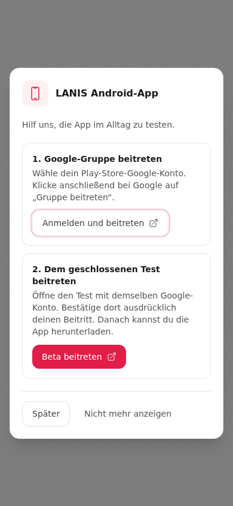 | 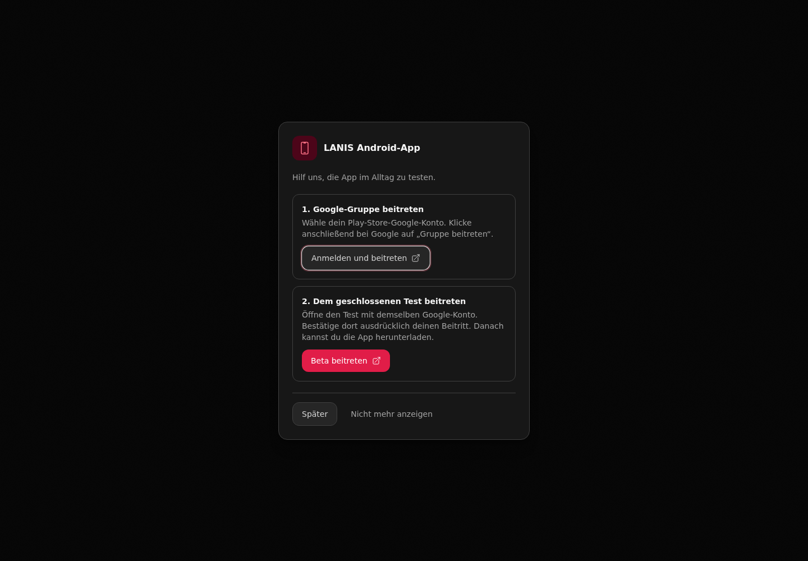 |

## Save failure and local close

| Mobile | Desktop |
| --- | --- |
| 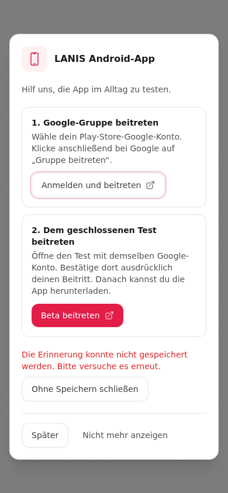 | 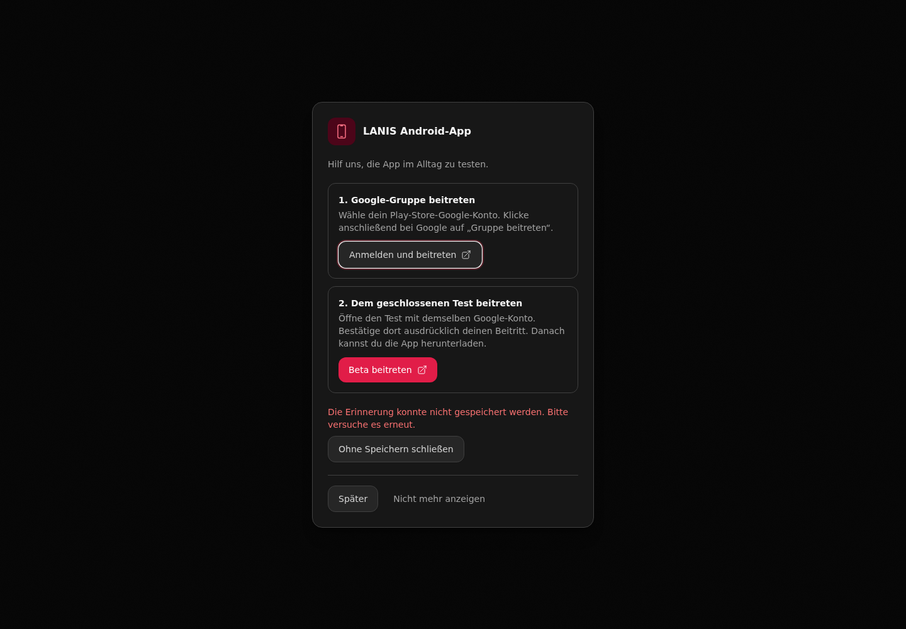 |

## App & Hilfe: compact entry card

| Mobile | Desktop |
| --- | --- |
| 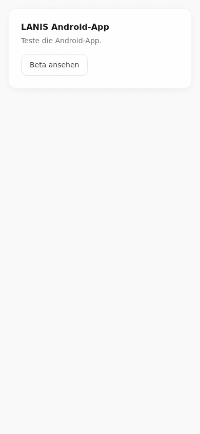 | 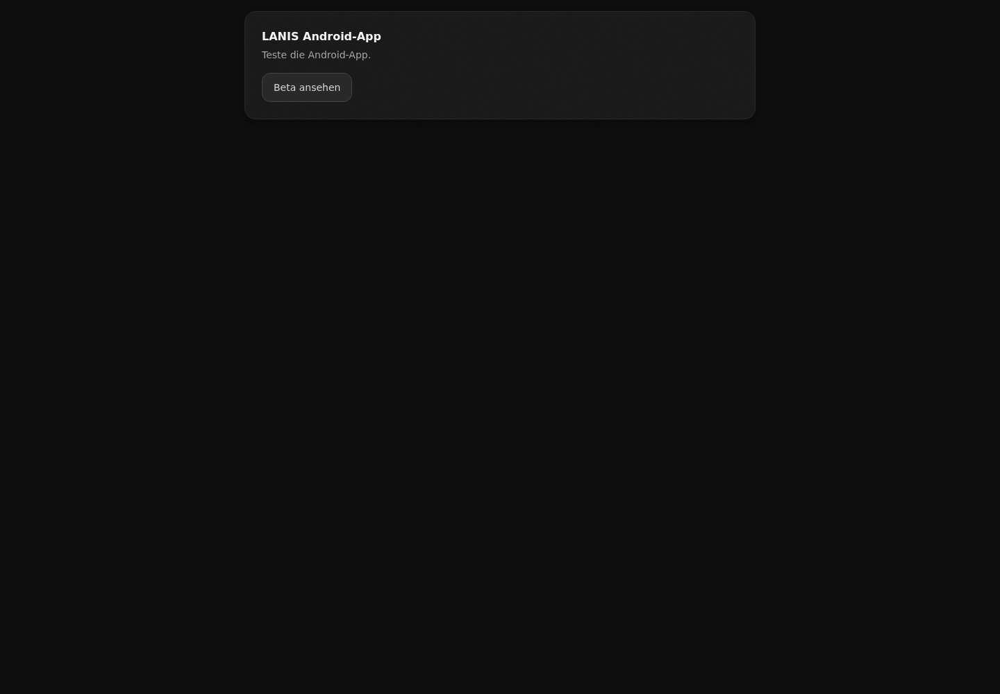 |

## Popup opened manually from App & Hilfe

| Mobile | Desktop |
| --- | --- |
| 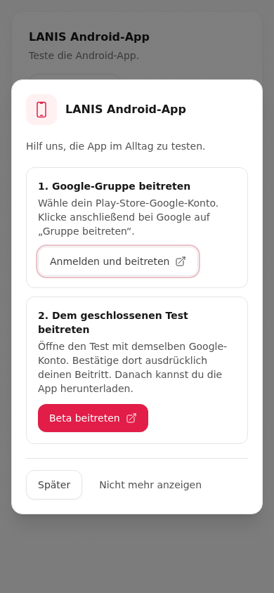 | 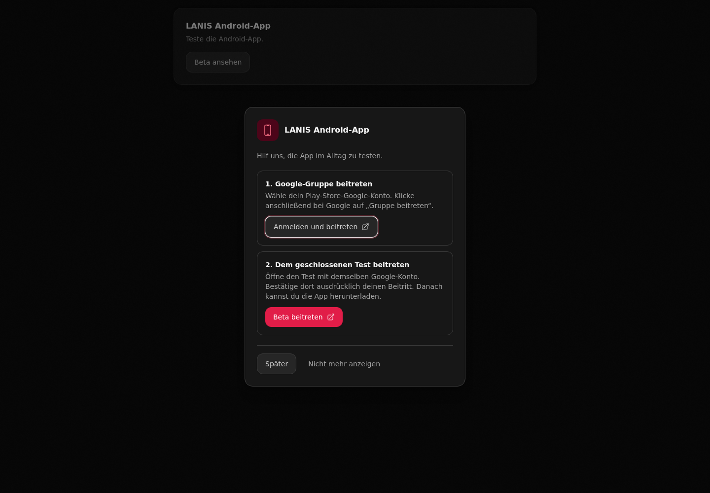 |

## App & Hilfe: recruitment unavailable

| Mobile | Desktop |
| --- | --- |
| 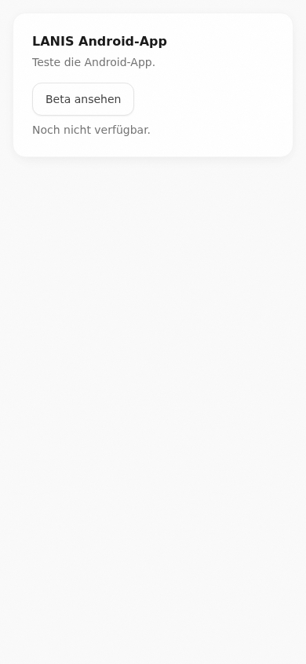 | 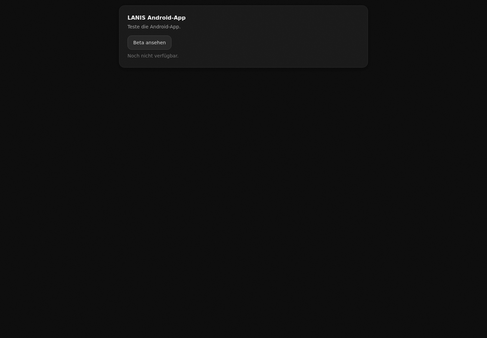 |

## Privacy disclosure

| Mobile | Desktop |
| --- | --- |
| 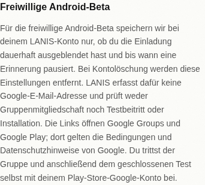 | 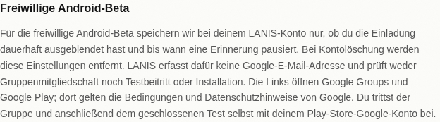 |

