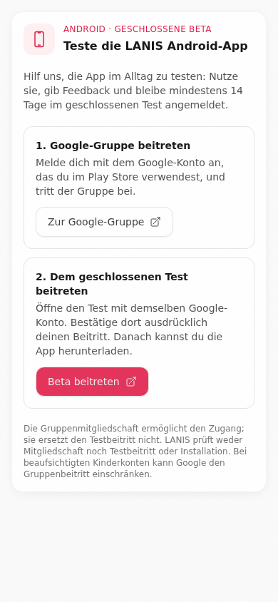
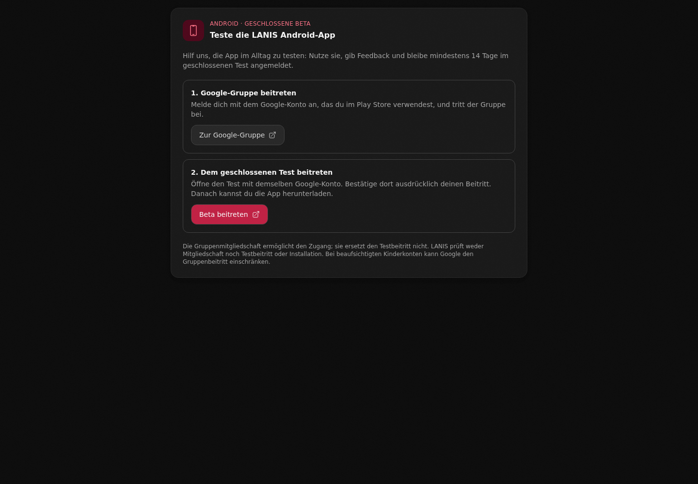
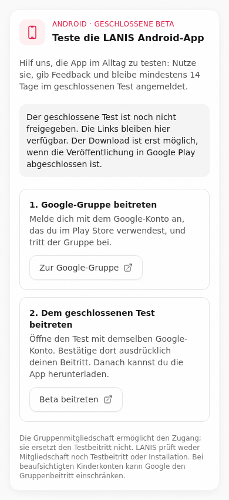
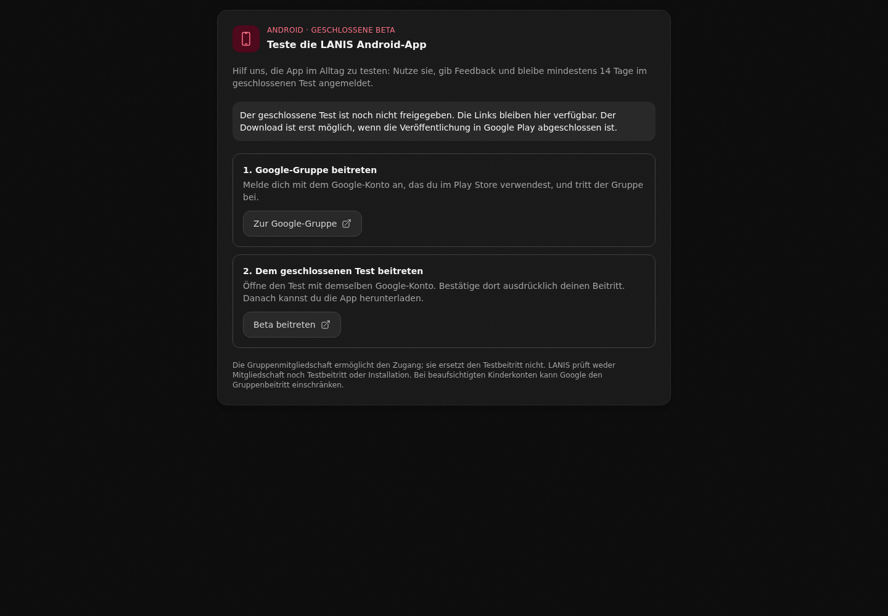
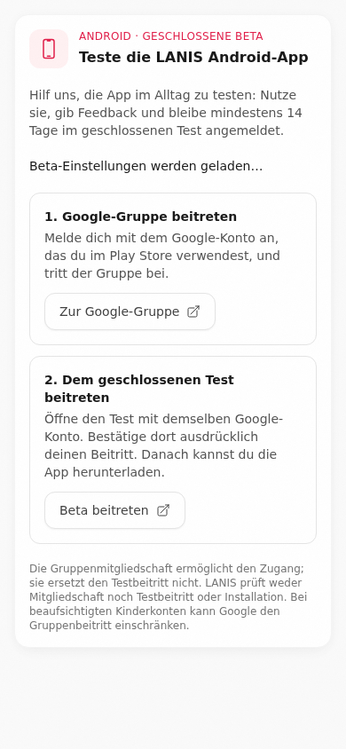
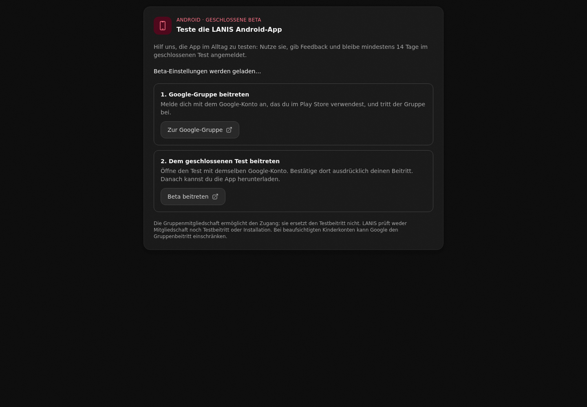
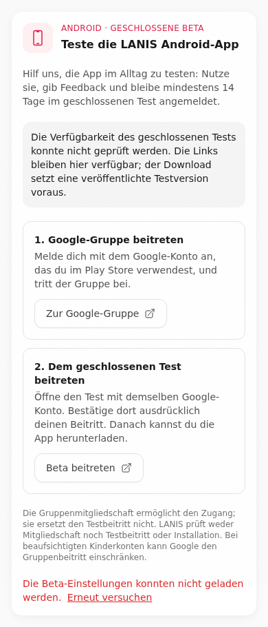
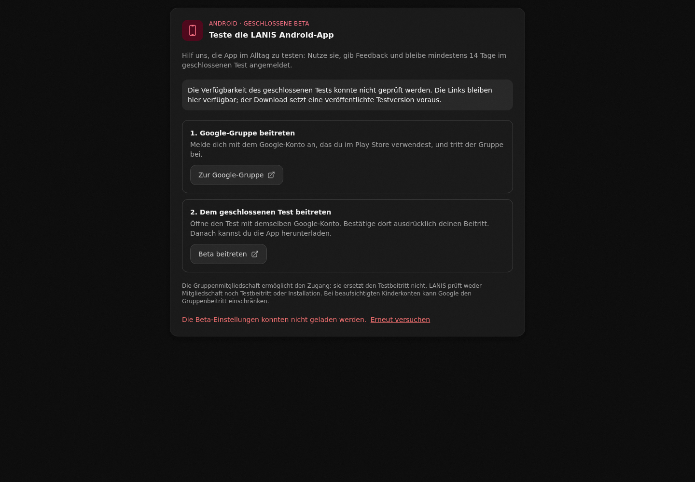

# Android beta screenshot gallery

Captured from application source commit `512f50a1e634a2b0820c4b584c2c1d3a78eb37f6`.
The actual AndroidBeta and PrivacyPolicy components use the production stylesheet,
with deterministic authentication/API fixtures. These are component captures,
not signed-in production sessions or evidence that the closed release is live.
No Google membership, Play enrollment, account data or production settings were changed.

Mobile captures use 390 × 844 CSS pixels in light mode. Desktop captures use
1440 × 1000 in dark mode (privacy retains its existing light styling).
Settings captures include the full component height; privacy images crop to the
changed disclosure. The mobile save-error dialog is scrolled to its error and
local close action, showing the real constrained viewport behavior.
Keyboard focus outlines are visible where Chromium placed focus on dialog open.

## Dashboard invitation

| Mobile / light | Desktop / dark |
| --- | --- |
|  |  |

## Save failure and local close fallback

| Mobile / light | Desktop / dark |
| --- | --- |
|  |  |

## Settings: recruitment enabled

| Mobile / light | Desktop / dark |
| --- | --- |
|  |  |

## Settings: recruitment disabled

| Mobile / light | Desktop / dark |
| --- | --- |
|  |  |

## Settings: loading preferences

| Mobile / light | Desktop / dark |
| --- | --- |
|  |  |

## Settings: failed preference load and retry

| Mobile / light | Desktop / dark |
| --- | --- |
|  |  |

## Updated privacy disclosure (changed section)

| Mobile / light | Desktop / dark |
| --- | --- |
|  |  |

